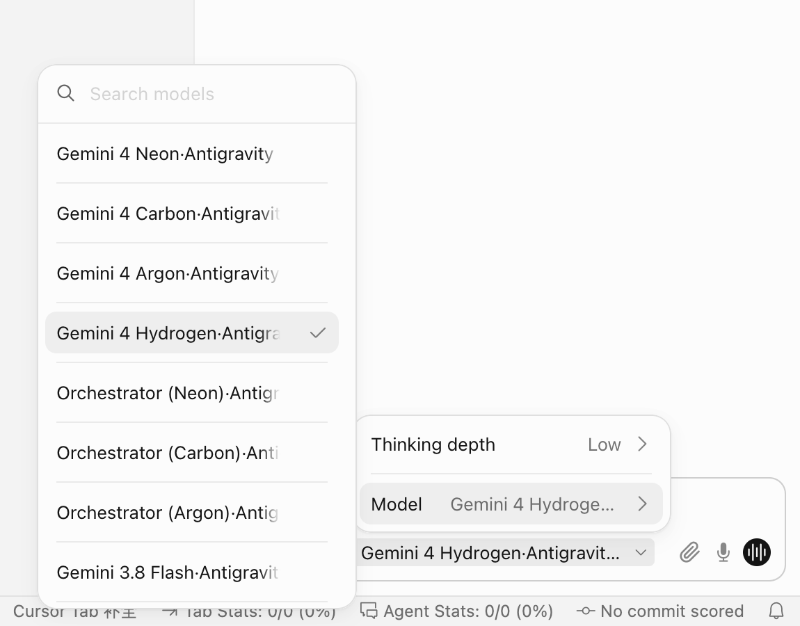
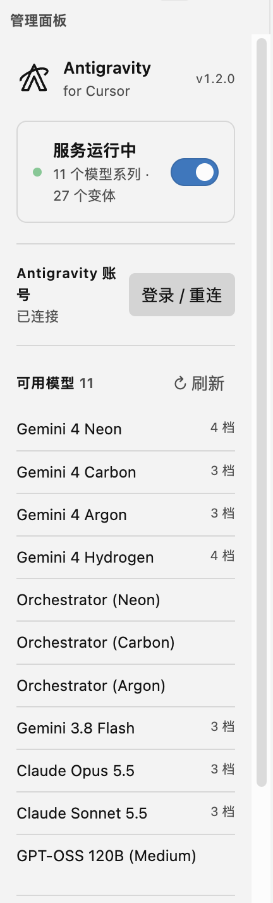
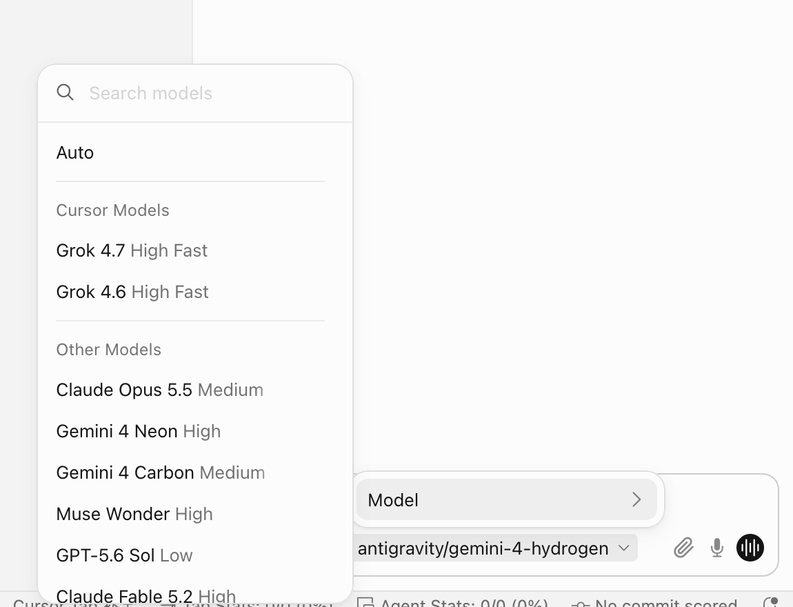
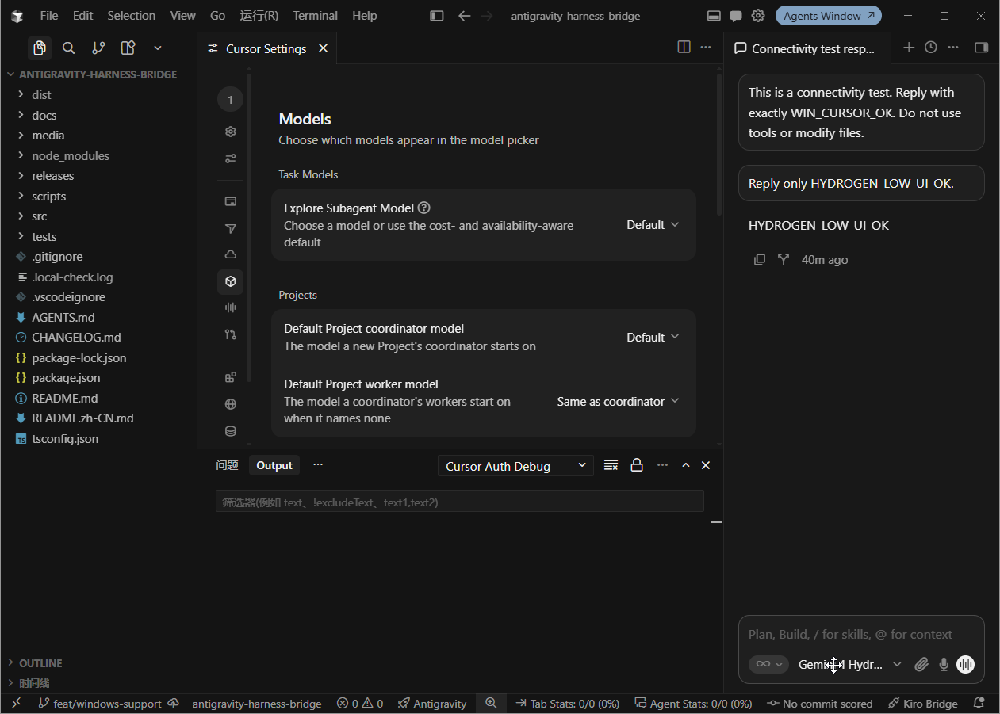
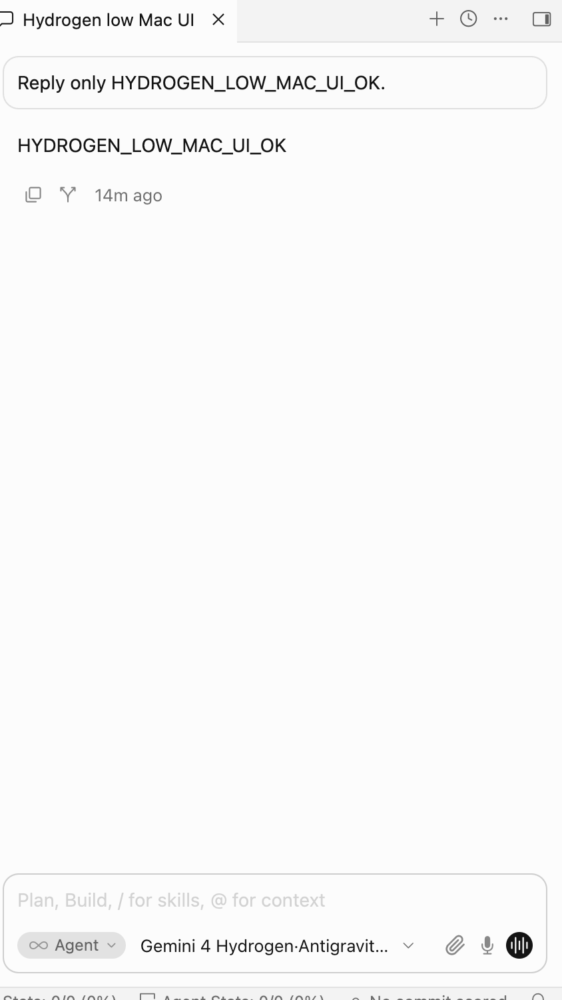
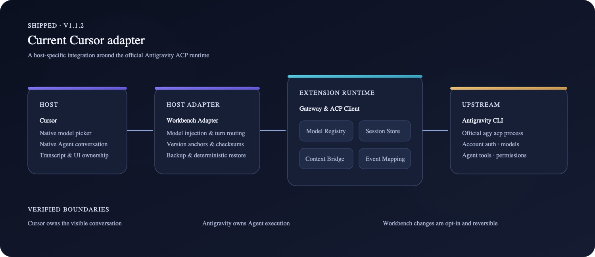
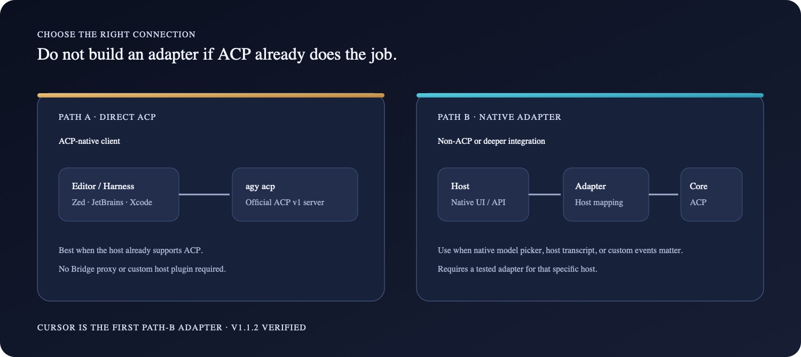

<div align="center">


# Antigravity Agent Bridge

**Bring your Antigravity models into Cursor's native Agent experience.**

Native model picker · Native thinking depth · Conversation continuity · Instant provider switching

[](https://github.com/rizetngan/antigravity-harness-bridge/releases/latest)   

English · [简体中文](README.zh-CN.md)

[Download](#download) · [Highlights](#highlights) · [Platforms](#platform-support) · [Installation](#installation) · [Agent-assisted installation](#agent-assisted-installation) · [Development](#development--validation)

</div>

<p align="center">


<br><sub>V1.2.0 on macOS: actual native picker and management panel.</sub>
</p>

Antigravity Agent Bridge is built around Google's official Antigravity CLI and Agent Client Protocol (ACP). **Keep the Cursor editor, native conversation, and familiar workflow while using the models available to your signed-in Antigravity account.** No separate chat interface or manual copying between IDEs.

The first production adapter is **Antigravity for Cursor**, validated on Windows and macOS. Other agent harnesses can use direct ACP where supported, or dedicated adapters where deeper integration is needed.

## Download

**V1.2.0 stable** · Windows x64 / macOS Apple Silicon · Verified with Cursor 3.28.7 and Antigravity CLI 1.5.18

**[Download VSIX (both platforms)](https://github.com/rizetngan/antigravity-harness-bridge/releases/download/v1.2.0/antigravity-cursor-1.2.0.vsix)** · [Release notes](https://github.com/rizetngan/antigravity-harness-bridge/releases/tag/v1.2.0) · [All releases](https://github.com/rizetngan/antigravity-harness-bridge/releases)

SHA-256 for the V1.2.0 VSIX:

```text
46937ff787ea1a7260f6e398baec1f2dae9fae276991381cca82bffee7ce4bbb
```

Requires Cursor and the [official Antigravity CLI](https://antigravity.google/docs/getting-started?tab=cli), with your own Antigravity account. Initial integration may require normal OS authorization; daily service switching does not require elevation or restart.

## Highlights

### Native model and reasoning-depth selection

Choose models inside Cursor's own picker. Labels such as `Gemini 4 Hydrogen·Antigravity` make the provider explicit; native thinking-depth controls expose only the options supported by the model.

The catalogue is discovered dynamically through ACP. The test account exposed 11 model families and 27 model/effort variants in V1.2.0; actual availability depends on the account and service.

### One switch, two provider modes

<p align="center">


<br><sub>Left: service started. Right: service stopped. Actual cropped menus.</sub>
</p>

| Action | Result |
| --- | --- |
| Start Service | Show only Antigravity models |
| Stop Service | Stop ACP and restore Cursor's original model directory |
| Temporary disconnect | Keep Antigravity mode; do not silently fall back to Cursor-billed models |
| Restore Cursor | Restore original Workbench resources and remove the integration |

Daily switching does not restart Cursor or delete existing conversations. If a conversation still points to an unavailable model after a provider change, explicitly select an available model before sending another message.

### Real native Agent conversations

<p align="center">

<br><sub>Windows: actual Gemini 4 Hydrogen Low request and response in Cursor.</sub>
</p>

<p align="center">

<br><sub>macOS: independently verified Hydrogen Low conversation.</sub>
</p>

Cursor owns the visible transcript. The adapter maps ACP sessions, synchronizes visible context, and translates streamed responses, supported tool events and checkpoints into Cursor's native conversation. Tool permissions depend on ACP and the capabilities of the host.

### A native panel with reversible integration

Open Antigravity from Cursor's status bar to start or stop the service, connect the account, refresh the model catalogue, or restore Cursor. Multiple windows share the authenticated loopback gateway. The official `agy acp` process remains responsible for agent execution.

The integration is version-checked, backs up modified Workbench resources and verifies their hashes. It is not a Cursor fork or a generic OpenAI-compatible proxy, and does not extract OAuth credentials.

## Why this approach?

| Approach | Antigravity for Cursor | Separate IDEs | Generic model API | ACP-native host |
| --- | --- | --- | --- | --- |
| UI | Native Cursor Agent | Each IDE separately | Client-dependent | Native host Agent |
| Model/effort picker | Native Cursor controls | Separate controls | Interface-dependent | Host-dependent |
| Execution | Official Antigravity ACP | Separate agents | Usually model requests | Official ACP |
| Continuity | Cursor-to-ACP session mapping | Manual workflow switching | Implementation-dependent | Host-dependent |
| Switching | Start / Stop Service | Change IDE | Change endpoint | Host-dependent |

For a client that already supports ACP, prefer Google's direct `agy acp` connection. The value of the native adapter is integration into the host's workflow, not building another model API.

## Platform support

| Platform / client | Status | Installation |
| --- | --- | --- |
| Windows x64 + Cursor 3.28.7 | Stable, live-tested | Shared VSIX; UAC for protected directories |
| macOS Apple Silicon + Cursor 3.28.7 | Stable, live-tested | Shared VSIX; App Management authorization as needed |
| Windows ARM64 / Intel Mac / Linux | Not live-tested | Compatibility not established |
| Zed, JetBrains and other ACP clients | Official direct ACP path | Follow client-specific Google documentation |
| Other non-ACP agent harnesses | Future adapters | Host-specific validation required |

Cursor integration depends on version-specific Workbench resources. Recheck compatibility when Cursor updates. [Client compatibility matrix](docs/client-compatibility.md)

## Installation

1. Install the official Antigravity CLI, verify `agy --version`, and follow the official sign-in flow.
2. Download the VSIX. In Cursor's Extensions view, choose **Install from VSIX...**.
3. Open **Antigravity** from the status bar and select **Enable Native Models**.
4. Confirm any required system permission, then fully quit and reopen Cursor.
5. Start Service and select a model and thinking depth in Cursor's native picker. Stop Service to return to native Cursor models.

**Upgrading:** restore the previous Workbench integration first, install the new VSIX, re-enable native models, then fully quit and reopen Cursor. Preserve your existing conversations and settings.

### Terminal installation

The following commands install the verified V1.2.0 release and check its checksum. Cursor and the official Antigravity CLI must already be installed. Initial integration is still confirmed from the management panel.

**macOS**

```bash
agy --version
set -e
file="/tmp/antigravity-cursor-1.2.0.vsix"
curl -fL --connect-timeout 15 \
  https://github.com/rizetngan/antigravity-harness-bridge/releases/download/v1.2.0/antigravity-cursor-1.2.0.vsix \
  -o "$file"
printf '%s  %s\n' \
  '46937ff787ea1a7260f6e398baec1f2dae9fae276991381cca82bffee7ce4bbb' \
  "$file" | shasum -a 256 -c -
"/Applications/Cursor.app/Contents/Resources/app/bin/cursor" \
  --install-extension "$file" --force
```

Adjust the CLI path if Cursor is installed elsewhere. Grant App Management permission through normal macOS settings if prompted.

**Windows PowerShell**

```powershell
$ErrorActionPreference = 'Stop'
agy --version
$file = Join-Path $env:TEMP 'antigravity-cursor-1.2.0.vsix'
Invoke-WebRequest -UseBasicParsing 'https://github.com/rizetngan/antigravity-harness-bridge/releases/download/v1.2.0/antigravity-cursor-1.2.0.vsix' -OutFile $file
$expected = '46937ff787ea1a7260f6e398baec1f2dae9fae276991381cca82bffee7ce4bbb'
if ((Get-FileHash $file -Algorithm SHA256).Hash -ine $expected) {
    throw 'SHA-256 verification failed'
}
cursor --install-extension $file --force
```

If `cursor` is not on PATH, use Install from VSIX in the editor or run `resources\app\bin\cursor.cmd` from the actual Cursor installation. Custom drives are supported. Cursor does not need to run as administrator permanently.

## Agent-assisted installation

Copy this prompt into an agent with access to the local computer, such as ChatGPT Work, Codex or Claude Code:

```text
Install the latest stable Antigravity Agent Bridge on this computer:
https://github.com/rizetngan/antigravity-harness-bridge

1. Check OS, architecture, Cursor and official Antigravity CLI versions against the tested compatibility range.
2. Download the latest stable VSIX only from this repository's GitHub Releases and verify its published SHA-256. Stop if the checksum does not match.
3. Check for an existing Workbench integration. Restore the previous integration before upgrading; preserve conversations and settings. Do not interrupt an active task.
4. Install the VSIX and open the Antigravity panel. Explain the opt-in Workbench patch and backup before enabling it. Let me confirm any OS authorization; do not bypass security.
5. Fully quit and reopen Cursor. Let me complete official Antigravity sign-in if needed.
6. Verify Start Service shows only Antigravity models, Stop Service restores native Cursor models, and a no-tool test message uses an account-available model and effort through ACP.
7. Report the installed version, checksum, real test result and any manual authorization steps.
```

## Recovery & troubleshooting

| Situation | Action |
| --- | --- |
| Models do not appear | Check service/account status, refresh the catalogue, and fully restart Cursor after initial integration |
| Temporarily return to Cursor models | Stop Service |
| Model is present but requests fail | Reconnect and verify that ACP still exposes the selected model |
| Updating Cursor or removing the extension | Restore Cursor first, then fully quit and reopen |
| Cursor cannot launch | Close it and run the standalone recovery launcher; Node.js 22+ must be on PATH |

Recovery launchers:

- Windows: `%LOCALAPPDATA%\Antigravity for Cursor\recovery\<installation-id>\Restore Cursor.cmd`
- macOS: `~/Library/Application Support/Antigravity for Cursor/recovery/<installation-id>/Restore Cursor.command`

Recovery uses the original backed-up resources and recorded hashes. Keep these backups; do not overwrite Workbench with resources from unrelated Cursor versions.

## Architecture & other agent harnesses

<p align="center"><br><sub>Current Cursor adapter architecture.</sub></p>

Antigravity owns execution, tools, permissions and account access. Cursor owns the host interaction and visible transcript. The local bridge handles discovery, session mapping, event conversion and service lifecycle.

<p align="center"></p>

ACP-native clients can connect directly using the [official Google ACP editor guide](https://antigravity.google/docs/ide/extensions/acp). For non-ACP clients and deeper native integration, a tested host adapter is required. Host-neutral Bridge Core and the Adapter SDK remain roadmap goals, not universal V1.2.0 capabilities.

[Architecture](docs/architecture.md) · [Roadmap](docs/roadmap.md) · [Adapter contract](docs/adapter-contract.md) · [Known limitations](docs/known-limitations.md)

## Development & validation

```bash
git clone https://github.com/rizetngan/antigravity-harness-bridge.git
cd antigravity-harness-bridge
npm install
npm run check
npm run package:vsix
```

V1.2.0 passed 45 automated tests per platform, real-resource patch and exact restoration checks, native provider switching, and live Gemini 4 Hydrogen Low conversations on both platforms. Screenshots are genuine application captures or crops, not mockups; see [image provenance](docs/images/README.md).

Independently maintained by [rizetngan](https://github.com/rizetngan). Antigravity and Cursor are their respective products; this project is not an official product of either.

[Issues](https://github.com/rizetngan/antigravity-harness-bridge/issues)
