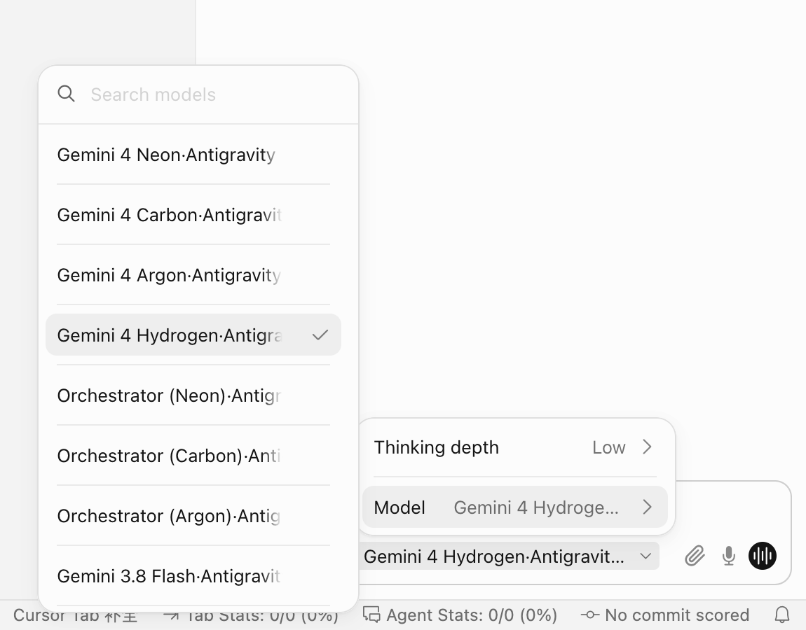
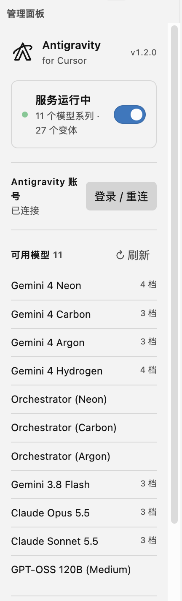
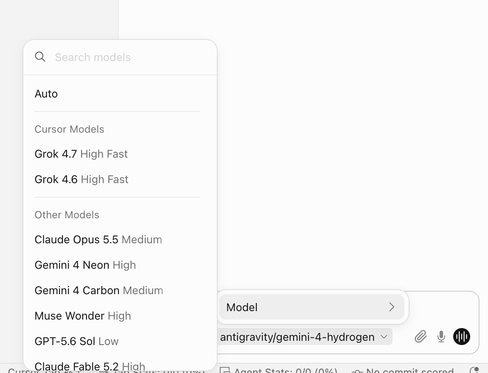
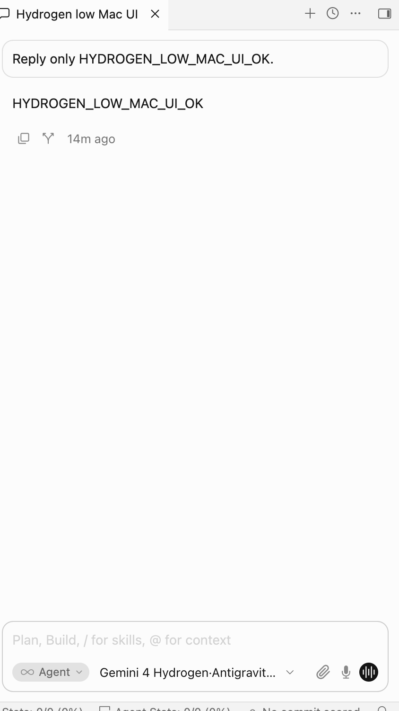
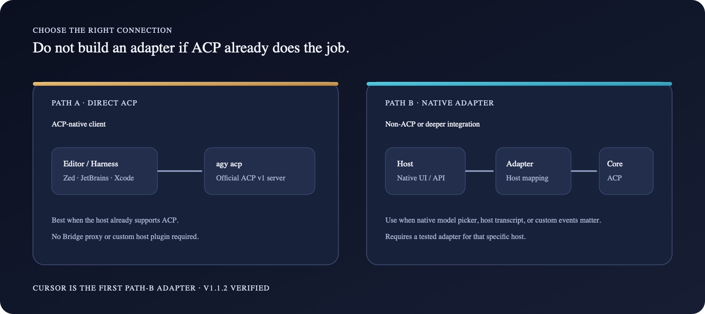

<div align="center">


# Antigravity Agent Bridge

**让 Antigravity 的模型直接进入 Cursor 原生 Agent 体验**

原生模型选择 · 原生思考深度 · 对话连续 · 一键切换模型来源

[](https://github.com/rizetngan/antigravity-harness-bridge/releases/latest)   

简体中文 · [English](README.md)

[下载](#下载安装) · [核心体验](#核心体验) · [平台支持](#平台支持) · [使用方法](#使用方法) · [使用-agent-安装](#使用-agent-安装) · [开发](#开发与验证)

</div>

<p align="center">


<br><sub>V1.2.0 macOS 实机界面：原生模型选择器 · Antigravity 管理面板</sub>
</p>

Antigravity Agent Bridge 是围绕 Google 官方 Antigravity CLI 和 Agent Client Protocol（ACP）构建的接入项目。**保留你熟悉的 Cursor 编辑器、聊天窗口和工作方式，将已登录 Antigravity 账号提供的模型接入其中。** 不需要在两个 IDE 之间来回复制代码和对话，也不需要另建聊天界面。

当前正式版提供 **Antigravity for Cursor** 原生适配器，Windows 与 macOS 均已实机验收。其他 Agent Harness 将根据其 ACP 支持情况选择直接接入或开发专用适配器。

## 下载安装

**V1.2.0 正式版** · Windows x64 / macOS Apple Silicon · 已验证 Cursor 3.28.7、Antigravity CLI 1.5.18

**[下载 VSIX（双平台通用）](https://github.com/rizetngan/antigravity-harness-bridge/releases/download/v1.2.0/antigravity-cursor-1.2.0.vsix)** · [发布说明](https://github.com/rizetngan/antigravity-harness-bridge/releases/tag/v1.2.0) · [全部版本](https://github.com/rizetngan/antigravity-harness-bridge/releases)

SHA-256（V1.2.0 VSIX）：

```text
46937ff787ea1a7260f6e398baec1f2dae9fae276991381cca82bffee7ce4bbb
```

需要预先安装 Cursor 和 [Google 官方 Antigravity CLI](https://antigravity.google/docs/getting-started?tab=cli)，并使用自己的 Antigravity 账号登录。首次启用原生接入时可能需要系统授权；日常启停不需要管理员权限或重启。

## 核心体验

### 1. 原生模型与思考深度

模型直接进入 Cursor 自己的模型选择器，并以 `模型名·Antigravity` 标记来源。通过 Cursor 原生参数菜单选择 Low、Medium、High 等账号实际支持的思考深度。

模型目录由官方 ACP 实时发现，不写死模型清单。V1.2.0 验收账号返回 11 个模型系列、27 种模型与思考深度组合；实际可用模型与额度以账号和服务为准。

### 2. 一键切换两套模型来源

<p align="center">


<br><sub>左：启动 Antigravity 服务 · 右：停止服务后恢复 Cursor 原生目录（真实菜单局部截图）</sub>
</p>

| 操作 | 实际效果 |
| --- | --- |
| 启动服务（Start Service） | 仅显示 Antigravity 模型 |
| 停止服务（Stop Service） | 停止 ACP，移除插件模型，恢复原生目录 |
| 临时掉线 | 保留 Antigravity 模式，不自动调用 Cursor 模型 |
| 恢复 Cursor（Restore Cursor） | 恢复原始 Workbench 文件，彻底退出原生接入 |

两种来源不混在一起；启停即时生效，历史对话不删除。当前对话若仍选择已停用的模型，应显式选择可用模型后再继续，避免误用其他来源。

### 3. 真实 Agent 对话，而非独立聊天框

<p align="center">

<br><sub>Windows 实机：Gemini 4 Hydrogen Low 真实请求与原生聊天结果</sub>
</p>

<p align="center">

<br><sub>macOS 实机：同一模型、Low 思考深度的独立验收</sub>
</p>

Cursor 保留可见聊天记录，适配器关联 ACP 会话、同步可见上下文，并将模型流式响应、可映射的工具事件与会话检查点返回原生界面。新旧对话不要求手动复制历史。实际工具权限由 ACP 与宿主能力共同决定。

### 4. 管理面板与可恢复接入

- 在 Cursor 状态栏打开 Antigravity 面板，统一查看运行状态、连接账号、刷新模型、启停服务与恢复接入。
- 多窗口复用本机认证网关；模型执行由官方 `agy acp` 负责。
- 首次接入会检查版本与结构锚点，并备份受影响的 Workbench 资源和校验信息；可通过恢复功能还原。
- 不是 Cursor 分叉，也不是通用 OpenAI API 反代；无需提取 OAuth 凭据。

## 为什么选择这个方案？

| 方案 | Antigravity for Cursor | 分开使用两个 IDE | 普通 OpenAI 兼容接口 | ACP 原生客户端 |
| --- | --- | --- | --- | --- |
| 工作界面 | Cursor 原生聊天 | 各自独立 | 依调用端 | 该客户端原生 Agent |
| 模型与参数 | Cursor 原生选择器 | 各自选择 | 依接口支持 | 依客户端支持 |
| Agent 执行 | 官方 Antigravity ACP | 各自 Agent | 通常是模型请求接口 | 官方 ACP |
| 对话连续性 | Cursor 与 ACP 会话映射 | 需自行切换上下文 | 依实现 | 依客户端实现 |
| 日常切换 | 启停服务 | 切换 IDE | 修改接口配置 | 依客户端 |

如果客户端本身已经支持 ACP，优先直接使用官方 `agy acp`，不必安装 Cursor 适配器。这个项目的增量价值在于将 Agent 能力接入宿主原生体验，而不是再造模型接口。

## 平台支持

| 平台 / 客户端 | 状态 | 安装方式 |
| --- | --- | --- |
| Windows x64 + Cursor 3.28.7 | 正式支持，实机验收通过 | 通用 VSIX；受保护目录需要 UAC |
| macOS Apple Silicon + Cursor 3.28.7 | 正式支持，实机验收通过 | 通用 VSIX；按需授予 App 管理权限 |
| Windows ARM64 / Intel Mac / Linux | 暂未实机验证 | 不承诺兼容 |
| Zed、JetBrains 等 ACP 客户端 | 官方 ACP 直连路径 | 按客户端及 Google 官方文档配置 |
| 其他非 ACP Agent Harness | 后续适配 | 按宿主 API 与能力评估 |

Cursor 原生适配器涉及版本特定的 Workbench 接入。升级 Cursor 后应重新检查兼容性，不应强行应用不匹配的补丁。[完整客户端兼容说明](docs/client-compatibility.md)

## 使用方法

1. 安装官方 Antigravity CLI，运行 `agy --version` 确认可用，按官方流程登录。
2. 下载 VSIX，在 Cursor 扩展页菜单选择 **Install from VSIX...**。
3. 点击状态栏 **Antigravity**，在管理面板选择 **Enable Native Models**（启用原生模型）。
4. 确认系统授权；完全退出并重新打开 Cursor，使新版 Workbench 接入生效。
5. 启动服务，在 Cursor 原生模型选择器选择模型及思考深度；停止服务即可恢复原生模型。

从旧版本升级时：**先恢复旧版 Workbench，再安装新 VSIX，重新启用并完整重启 Cursor**。已存在的聊天记录和用户设置无需删除。

### 命令行安装

以下命令安装 V1.2.0 已验证正式版，适用于已经安装 Cursor 和官方 Antigravity CLI 的电脑。命令只安装扩展；首次启用接入仍通过管理面板确认。

**macOS · Terminal**

```bash
agy --version
set -e
file="/tmp/antigravity-cursor-1.2.0.vsix"
curl -fL --connect-timeout 15 \
  https://github.com/rizetngan/antigravity-harness-bridge/releases/download/v1.2.0/antigravity-cursor-1.2.0.vsix \
  -o "$file"
printf '%s  %s\n' \
  '46937ff787ea1a7260f6e398baec1f2dae9fae276991381cca82bffee7ce4bbb' \
  "$file" | shasum -a 256 -c -
"/Applications/Cursor.app/Contents/Resources/app/bin/cursor" \
  --install-extension "$file" --force
```

若 Cursor 安装在其他位置，请调整 CLI 路径。首次启用若出现 macOS App 管理权限提示，按系统设置正常授权。

**Windows · PowerShell**

```powershell
$ErrorActionPreference = 'Stop'
agy --version
$file = Join-Path $env:TEMP 'antigravity-cursor-1.2.0.vsix'
Invoke-WebRequest -UseBasicParsing 'https://github.com/rizetngan/antigravity-harness-bridge/releases/download/v1.2.0/antigravity-cursor-1.2.0.vsix' -OutFile $file
$expected = '46937ff787ea1a7260f6e398baec1f2dae9fae276991381cca82bffee7ce4bbb'
if ((Get-FileHash $file -Algorithm SHA256).Hash -ine $expected) {
    throw 'SHA-256 verification failed'
}
cursor --install-extension $file --force
```

如果 `cursor` 不在 PATH，请在 Cursor 中使用安装 VSIX 菜单，或运行实际安装目录中的 `resources\app\bin\cursor.cmd`。Windows 支持自定义盘符，不需要长期以管理员身份运行 Cursor。

## 使用 Agent 安装

将以下指令复制给可以操作本机的 Agent，例如 ChatGPT Work、Codex 或 Claude Code：

```text
请帮我在这台电脑安装 Antigravity Agent Bridge 最新稳定正式版：
https://github.com/rizetngan/antigravity-harness-bridge

1. 检查操作系统、CPU 架构、Cursor 和官方 Antigravity CLI 版本。确认是否在已验证范围内，不使用第三方模型代理。
2. 从本仓库 GitHub Releases 选择最新稳定版 VSIX，使用该版本公布的 SHA-256 校验文件；不一致则停止。
3. 检查是否存在旧版 Workbench 接入。如需升级，先通过旧版 Restore Cursor 恢复；保留聊天记录和已有设置，不强制终止正在执行的任务。
4. 通过 Cursor 安装 VSIX，打开 Antigravity 管理面板。启用原生模型前说明需要修改并备份 Workbench 资源，由我确认必要的系统授权。不要绕过安全校验。
5. 完全退出并重新打开 Cursor；若需登录 Antigravity，由我使用官方登录流程完成。
6. 验证启动后只出现 Antigravity 模型、停止后恢复原生模型。选择账号实际可用的模型及思考深度，发送一条无工具的测试消息，确认请求进入 ACP 后端。
7. 告诉我安装版本、校验结果、实际模型调用结果和需要我手动完成的授权步骤。
```

## 恢复与故障排查

| 情况 | 建议 |
| --- | --- |
| 模型没有出现 | 检查账号连接和管理面板状态，刷新模型；首次接入后完整退出再打开 Cursor |
| 仅希望暂时使用 Cursor 原生模型 | 点击停止服务，无需卸载 |
| 模型已出现但无法调用 | 在面板重连账号，检查该模型是否仍由 ACP 提供 |
| Cursor 更新或准备卸载插件 | 先执行 Restore Cursor，恢复完成后完整退出再打开 |
| 无法启动 Cursor | 完全退出后运行独立恢复工具；Node.js 22+ 需在 PATH 中 |

独立恢复工具位于：

- Windows：`%LOCALAPPDATA%\Antigravity for Cursor\recovery\<安装标识>\Restore Cursor.cmd`
- macOS：`~/Library/Application Support/Antigravity for Cursor/recovery/<安装标识>/Restore Cursor.command`

恢复工具使用接入时创建的原始备份和校验信息。不要手动删除备份或通过其他版本的 Workbench 文件覆盖当前程序。

## 架构与跨客户端方向

<p align="center"><br><sub>当前 Cursor 适配器架构</sub></p>

Antigravity 负责执行、权限、工具与账号模型能力；Cursor 负责宿主交互和可见聊天；本地 Bridge 负责模型目录、会话映射、事件转换与服务生命周期。

<p align="center"></p>

ACP 原生客户端可以按照 [Google ACP 编辑器接入指南](https://antigravity.google/docs/ide/extensions/acp) 直接运行 `agy acp`；非 ACP 或要求更深原生集成的客户端需要独立适配器。Host-neutral Bridge Core 与 Adapter SDK 仍为后续演进目标，不是 V1.2.0 已交付的通用接入能力。

[架构](docs/architecture.md) · [路线图](docs/roadmap.md) · [适配器规范](docs/adapter-contract.md) · [已知限制](docs/known-limitations.md)

## 开发与验证

```bash
git clone https://github.com/rizetngan/antigravity-harness-bridge.git
cd antigravity-harness-bridge
npm install
npm run check
npm run package:vsix
```

V1.2.0：双平台各 45 项自动化测试通过，真实 Workbench 资源补丁及逐文件恢复校验通过。两端均完成原生模型选择、服务启停循环和 Gemini 4 Hydrogen Low 实际对话验收。截图为真实测试窗口的原始画面或局部裁剪；详见[截图说明](docs/images/README.md)。

项目由 [rizetngan](https://github.com/rizetngan) 独立维护。Antigravity 与 Cursor 属于各自的产品及服务，本项目不代表两者官方。

[问题反馈](https://github.com/rizetngan/antigravity-harness-bridge/issues)
