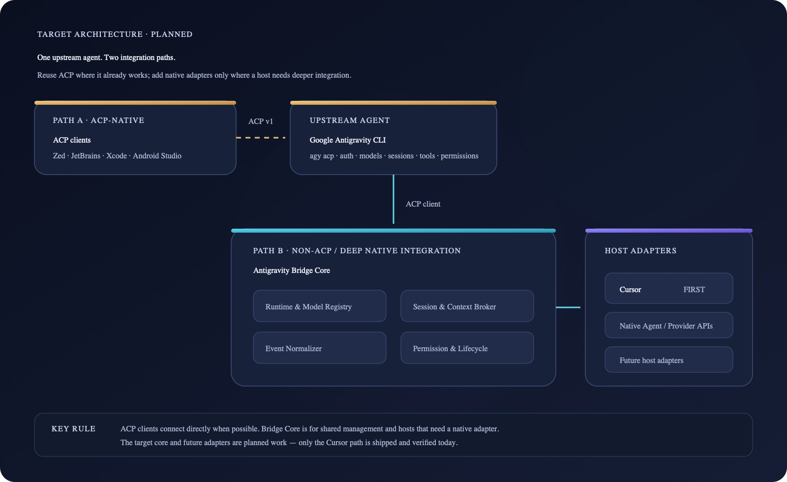
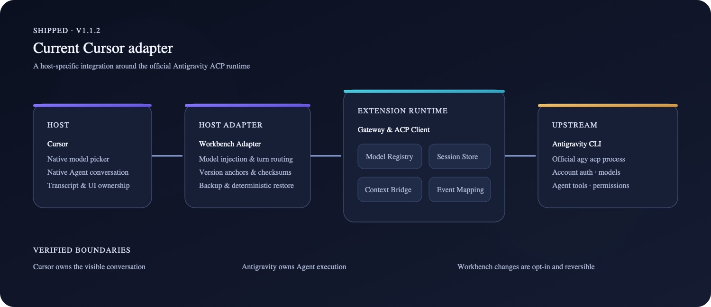
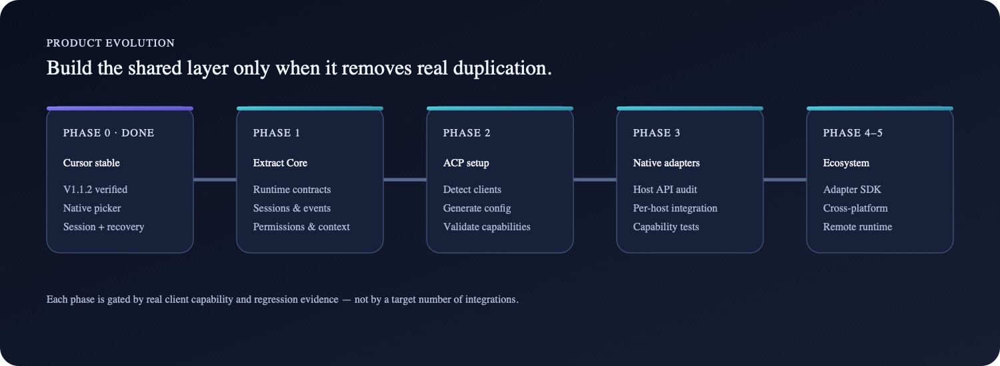

# Antigravity Agent Bridge

**让 Google Antigravity 接入 Cursor 及更多 Agent Harness 客户端。**

项目以 Google 官方 Antigravity CLI / ACP 为上游，把 Antigravity 的 Agent 执行能力接入不同开发客户端。Cursor 是第一个已经落地的原生适配器；支持 ACP 的编辑器则可以直接连接 agy acp。

[English README](README.md) · [架构说明](docs/architecture.md) · [升级路线](docs/roadmap.md) · [客户端兼容性](docs/client-compatibility.md)

## 项目定位

不再把项目定义为 Cursor 插件，而是拆成三个层次：

- **上游 Agent：** 使用用户已登录的 Antigravity CLI，通过官方 agy acp 提供 Agent 能力。
- **Bridge Core（目标架构）：** 统一处理模型目录、会话、事件流、上下文、权限和服务生命周期。
- **客户端适配器：** 面向不同 Agent Harness 的原生接入层。

目标不是重做一个 Agent，也不是搭建第三方模型代理。Antigravity 仍然负责 Agent 执行、工具编排、账号认证和模型访问。

## 当前已经完成

**V1.1.2 · macOS Apple Silicon · 已验证基线 Cursor 3.28.7**

- 通过官方 Antigravity CLI / ACP 获取账号实时模型目录。
- Antigravity 模型进入 Cursor 原生模型选择器，支持模型及其提供的推理深度选项。
- 保留 Cursor 原生对话界面，并完成上下文读取、ACP 会话映射和原生消息回写。
- 原生管理面板、服务启停、模型刷新和账号重新连接。
- 多个 Cursor 窗口共享一个已认证的本地 Gateway。
- 39 项自动化测试通过，生命周期和工具处理探测通过。
- Workbench 修改采用主动启用、版本校验、备份、哈希验证和可恢复机制。

Cursor 没有提供公开 API 来注册任意第三方模型供应商，因此当前 Cursor 适配器使用范围较窄、按版本校验、可恢复的 Workbench 兼容层。它不替换 Cursor 可执行文件，也不制作 Cursor Fork。

## 两种客户端接入路径

### 路径一：客户端原生支持 ACP，直接连接

这是成本最低、最应该优先采用的方式。客户端只需将 agy acp 注册为外部 Agent。

~~~sh
agy --version
agy acp --help
~~~

例如 Zed 的配置：

~~~json
{
  "agent_servers": {
    "Antigravity": {
      "type": "custom",
      "command": "agy",
      "args": ["acp"]
    }
  }
}
~~~

Google 官方已经提供 Zed、JetBrains IDE、Android Studio、Xcode 的 ACP 接入方式；VS Code 可通过社区维护的 ACP Client 扩展接入。此类客户端不需要我们再开发一套重复的 Bridge 适配器。

**但模型可见范围并不完全一致。** Google 当前 ACP 文档说明：Gemini 模型可在所有 ACP 客户端使用；第三方模型只向 JetBrains、Android Studio、Zed、Xcode 等指定客户端开放。具体以 [Google 官方 ACP 客户端文档](https://antigravity.google/docs/ide/extensions/acp) 为准。

### 路径二：客户端不支持 ACP，或需要更深的原生集成

例如需要把模型放进客户端自己的模型选择器、沿用客户端原生对话、映射工具事件和权限，就需要针对宿主提供独立适配器。

Cursor 就是第一个实例。后续客户端必须先验证其公开扩展 API 或 Agent API，再决定适配方式。**不能把一个 OpenAI 兼容接口简单等同于完整的 Agent Harness 接入。**

## 当前 Cursor 安装方式

1. 从 [GitHub Releases](https://github.com/rizetngan/antigravity-harness-bridge/releases) 下载 VSIX。
2. 在 Cursor 中打开 Antigravity 管理面板。
3. 点击 **Enable Native Models**，确认启用 Workbench 兼容补丁。
4. 重载 Cursor；如提示认证，按官方 Antigravity CLI 流程登录。
5. 在 Cursor 原生模型选择器中选择 Antigravity 模型。

从旧版本升级时，先执行旧版本的 **Restore Cursor**，再安装新 VSIX。当前实现、恢复方式和边界见[架构说明](docs/architecture.md)。

## 后续升级路线

1. **保持 Cursor 稳定：** 保留 V1.1.2 已验证适配器及确定性恢复能力。
2. **抽离通用核心：** 将 Antigravity Runtime、模型目录、会话、标准事件、权限和上下文契约从 Cursor 代码中拆开。
3. **优先复用 ACP：** 对已有 ACP 支持的客户端直接使用官方协议，不重复开发。
4. **按需开发原生适配器：** 只有宿主公开 API 能带来实质能力时才开发专用适配器。
5. **开放适配器规范：** 让新增客户端复用上游进程、会话和权限能力，不再重复造轮子。

具体阶段、验收条件见[升级路线](docs/roadmap.md)。

## 文档

| 文档 | 内容 |
|---|---|
| [架构说明](docs/architecture.md) | 当前实现与多客户端目标架构 |
| [升级路线](docs/roadmap.md) | 阶段划分和验收标准 |
| [客户端兼容性](docs/client-compatibility.md) | ACP 直连客户端与原生适配器候选 |
| [适配器规范](docs/adapter-contract.md) | 后续客户端适配器的统一接口 |
| [已知限制](docs/known-limitations.md) | 当前版本已经确认的限制 |

## 开发

~~~sh
npm install
npm run check
npm run probe:acp
npm run probe:cursor-context
npm run probe:gateway
npm run probe:extension-activation
npm run install:test-copy
npm run verify:test-copy
npm run restore:test-copy
npm run package:vsix
~~~

## 安全与设计边界

- 只使用官方 agy acp 和 Antigravity 自身的登录流程。
- 不提取 OAuth 凭据，不制作第三方订阅代理。
- 不静默回退到 Cursor 计费模型或其他模型。
- 客户端私有兼容代码与通用运行时隔离。
- 读取客户端历史时排除隐藏推理和系统提示词。
- 权限必须明确映射；无法表达的权限决策默认拒绝，不自动放行。
- 不宣称“任意客户端即插即用”：每个非 ACP 客户端都必须有经过测试的适配器和能力矩阵。

## 命名

GitHub 仓库名为 antigravity-harness-bridge，产品名为 **Antigravity Agent Bridge**。现有 VSIX 继续作为 **Antigravity for Cursor** 适配器，避免改变已安装插件的身份。
