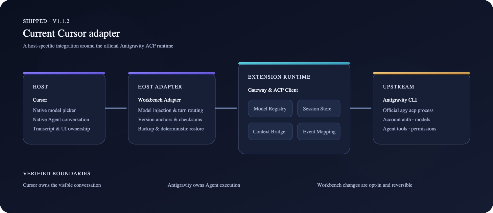
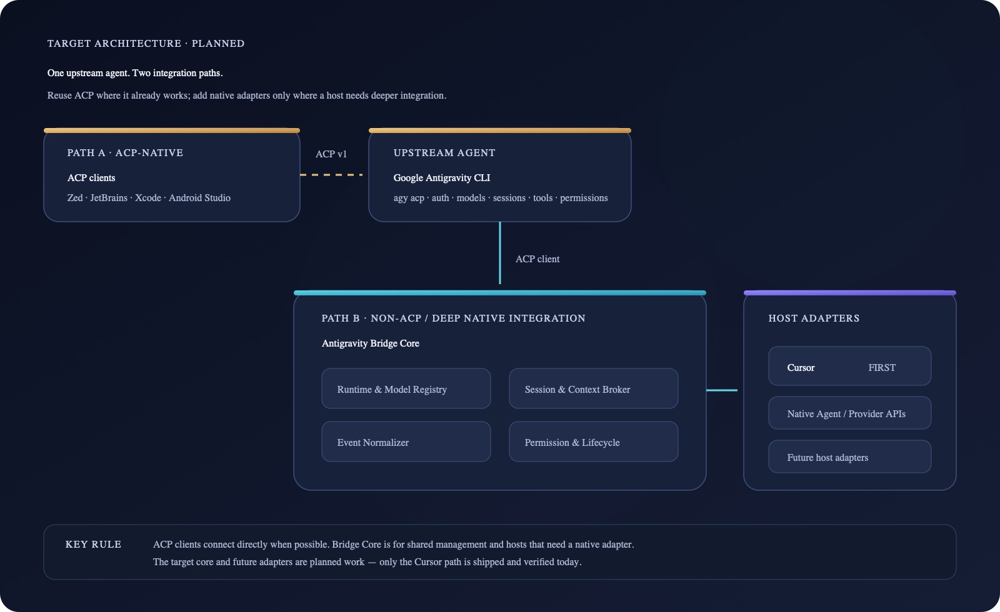

# 架构说明：从 Cursor 插件到多 Harness Bridge

## 1. 核心判断

项目的上游已经有标准协议：Google Antigravity CLI 提供官方 agy acp，以 ACP v1 / JSON-RPC over stdio 对外提供 Agent 服务。

因此不应该为每一个 ACP 客户端重新写一套连接逻辑。真正需要建设的是：

1. 对 ACP 客户端：直接复用官方 agy acp。
2. 对非 ACP 客户端或需要原生模型选择器、对话接管、上下文映射的客户端：通过统一核心加宿主适配器接入。
3. 把 Cursor 当前实现中的通用能力抽离，避免未来每增加一个客户端就复制一套 ACP 进程、模型目录和会话逻辑。

## 2. 当前 V1.2.0 实际架构

当前代码主要由以下部分构成：

| 当前模块 | 职责 | 后续归属 |
|---|---|---|
| src/acp/AntigravityAcpProcess.ts | 启动和管理 agy acp，处理 ACP 连接 | upstream/antigravity-acp |
| src/acp/AcpClientHandlers.ts、handlers/ | 文件、终端、权限等 ACP 处理器 | core + upstream |
| src/gateway/AntigravityGateway.ts | 服务生命周期、模型目录、共享 Gateway、会话协调 | 拆分为 core/runtime 与 platform/gateway |
| src/gateway/runAdapter.ts | 把 Cursor 单次 Agent 执行交给 ACP | adapters/cursor |
| src/catalog/modelCatalog.ts | 将 ACP 模型与参数整理成可供宿主使用的目录 | core/catalog |
| src/session/SessionStore.ts | Cursor 对话 ID 与 ACP Session ID 的映射 | core/session |
| src/context/CursorConversationReader.ts | 读取 Cursor 原生历史与 Agent 执行记录 | adapters/cursor/context |
| src/context/ContextSnapshot.ts、NativeHistory.ts | 上下文裁剪、排序和校验 | core/context |
| src/cursor/compat.ts | Cursor Workbench 模型注入、执行拦截、恢复 | adapters/cursor/workbench |
| src/ui/、src/renderer/ | Cursor 原生管理面板与界面事件 | adapters/cursor/ui |

当前已经实现的是 Cursor 专用的端到端链路，不是已经完成的通用 Harness SDK。抽象核心是下一阶段的工作，不能把目标架构写成现有能力。

## 3. 目标多客户端架构

### 上游：Antigravity Runtime

保持官方 CLI 作为唯一上游：

- 账号登录与凭据由 Antigravity CLI 管理。
- 模型列表及可用参数从 ACP 动态发现。
- Agent 执行、工具编排、会话、权限请求由 ACP 负责。
- 不提取 OAuth Token，不绕过账号或订阅体系。

### 核心：Bridge Core

从当前 Cursor 插件中抽出一组宿主无关能力：

| 核心服务 | 输入 | 输出 |
|---|---|---|
| Runtime Manager | ACP 进程、连接状态 | 统一启动、停止、重连和健康状态 |
| Model Registry | ACP availableModels 与配置选项 | 标准模型目录、能力和参数 |
| Session Manager | Host Session、ACP Session | 会话映射、恢复和关闭 |
| Event Normalizer | ACP 通知和工具事件 | 标准文本、工具、Diff、权限、完成事件 |
| Context Broker | 宿主提供的可见历史 | 有边界的上下文快照与增量 |
| Permission Broker | 宿主权限能力与 ACP 请求 | 明确的 Allow / Deny / Cancel 决策 |
| Capability Registry | 宿主和 ACP 能力 | 可用功能声明，避免虚假支持 |
| Lifecycle & Recovery | 宿主安装状态 | 版本校验、备份、恢复和清理 |

Bridge Core 不直接读取某个客户端的数据库，也不包含 Cursor Workbench 私有补丁。

### 下游：两类接入

**A. ACP-native client**

客户端直接启动 agy acp。Bridge 可以提供配置检测、安装向导和连接诊断，但不应再包一层协议代理，除非共享管理、远程接入等功能确实带来价值。

**B. Native host adapter**

当客户端没有 ACP 客户端能力，或者需要更深的原生集成时，适配器把宿主 API 转换为 Bridge Core 的标准接口。Cursor 是第一个适配器。

## 4. 两条链路不能混为一谈

### Agent Runtime 接入

完整 Agent 体验至少需要处理：

- 文本流式输出；
- 工具调用与工具结果；
- 文件 Diff / 编辑结果；
- 权限请求及决策；
- Session 创建、恢复、取消和关闭；
- 模型与推理参数；
- Workspace 和上下文；
- 错误与中断状态。

### Model API 接入

把 ACP 转成 OpenAI-compatible Chat Completions / Responses，只能视为独立的模型接口兼容模式。它不自动具备完整 Agent 语义，也不等于宿主原生 Agent Harness 集成。

因此，不把 OpenAI-compatible API proxy 作为主架构。如果将来确有只接受模型 API 的客户端，再单独定义受限能力模式，明确它无法完整保留哪些 Agent 能力。

## 5. 事件与上下文边界

Bridge Core 应统一以下事件：

- assistant.delta
- tool.started / tool.updated / tool.completed
- permission.requested / permission.resolved
- diff.updated
- session.state
- turn.completed / turn.cancelled / turn.failed
- model.catalogue.updated
- runtime.error

上下文规则：

1. 只传输宿主可见、用户有权使用的内容。
2. 排除隐藏推理、系统提示词和内部思考块。
3. 保留消息顺序和必要的工具摘要。
4. 使用增量与长度预算，不能无边界复制整个对话。
5. 图片、文件和多模态附件按宿主与 ACP 能力显式协商；不支持时明确提示。

## 6. 权限与工具归属

Antigravity 是上游 Agent 时，工具执行与权限流程优先由 Antigravity ACP 负责。宿主如果要向 Agent 提供 IDE 工具，可以在 ACP 支持范围内通过客户端 MCP 能力传入。

适配器不得擅自把宿主的工具调用转换成自动授权。若宿主无法表达某类权限请求，默认拒绝或中止该能力，而不是静默放行。

## 7. Cursor 当前接入方式

Cursor 的公共扩展 API 目前没有提供通用的原生第三方模型供应商注册入口。当前实现因此使用版本限定的 Workbench 兼容适配器：

- 注入动态模型目录；
- 只拦截被明确选中的 Antigravity 模型请求；
- 读取 Cursor 可见历史并映射到 ACP Session；
- 把 ACP 结果写回 Cursor 原生对话结构；
- 备份、哈希校验和恢复原始 Workbench 文件。

该适配器保持独立。Cursor 更新后必须重新验证结构锚点、哈希、Desktop / Glass 资源和完整恢复流程。

## 8. 建议的代码边界

不急于拆成多个 npm package。先在现有仓库内建立清晰模块边界，等第二个真实适配器通过验收后再考虑 workspace monorepo。

~~~text
src/
  core/
    contracts/
    catalog/
    session/
    events/
    context/
    permissions/
  upstream/
    antigravity-acp/
  adapters/
    cursor/
      workbench/
      context/
      ui/
    <host-id>/
  platform/
    process/
    storage/
    logging/
  cli/
~~~

迁移原则：先定义接口和测试，再移动实现；每次只抽离一条职责链，保证 V1.2.0 Cursor 行为不回退。

## 9. 官方协议参考

- [Google Antigravity CLI — ACP](https://antigravity.google/docs/cli/acp)
- [Google Antigravity — Other editors (ACP)](https://antigravity.google/docs/ide/extensions/acp)
- [Agent Client Protocol](https://agentclientprotocol.com/)
- [JetBrains ACP overview](https://www.jetbrains.com/acp/)
