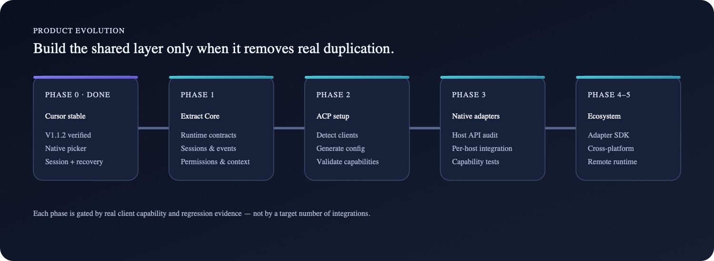

# 升级路线：从单一 Cursor 适配器到多 Harness 接入

## 产品目标

让 Antigravity 成为可接入多个 Agent Harness 客户端的上游 Agent Runtime，同时保留每个客户端原生的交互方式。

不追求“所有客户端都用同一种插件”。采用 **ACP 优先、原生适配补齐** 的路线。

## Phase 0 — 稳定当前 Cursor Adapter

**已完成：V1.1.2**

- Antigravity 官方 ACP 连接。
- Cursor 原生模型选择器和 Agent 执行链路。
- 对话上下文与 Session 映射。
- 原生管理面板、服务生命周期和多窗口共享 Gateway。
- Workbench 版本校验、备份、哈希验证和恢复。
- 39 项自动化测试通过。

**验收基线：** Cursor 3.28.7 / macOS Apple Silicon；日常 Cursor 安装不参与开发测试。

## Phase 1 — 抽离 Bridge Core

**下一阶段**

目标：让通用运行时不再依赖 Cursor 的类型、事件和目录结构。

交付：

1. 定义 AgentRuntime、AgentSession、AgentModel、AgentEvent、PermissionRequest 等公共契约。
2. 把 ACP 进程和协议处理独立为 Antigravity upstream driver。
3. 将模型目录、Session Store、上下文快照和权限映射从 Cursor 代码中拆开。
4. 将 runAdapter.ts、compat.ts、Cursor history reader 归入 Cursor adapter。
5. 建立核心层单元测试与 Cursor 行为回归测试。

**验收：**
- 核心层不 import Cursor 私有类型或 Workbench 代码。
- Cursor Adapter 仍通过原有 39 项测试及新增回归测试。
- ACP 进程只由一个 Runtime Manager 管理。
- 模型、会话、权限和事件有明确能力声明。

## Phase 2 — ACP 客户端接入体验

目标：对已经支持 ACP 的客户端提供最短配置路径，不重复造协议适配器。

优先覆盖：

- Zed
- JetBrains IDEs
- Android Studio
- Xcode
- VS Code（通过社区 ACP Client 扩展）

交付：

- agy 命令与登录状态检测。
- ACP 能力和版本检测。
- 生成对应客户端配置的向导或 CLI 命令。
- 模型可见性、Thinking 参数和权限能力检查。
- 一键复制配置与诊断信息。

**验收：**
- 每个客户端至少完成一次真实连接、工具调用、权限确认和 Session 恢复测试。
- 不支持的模型或参数必须明确显示，不伪装成已支持。
- 直接运行官方 agy acp 即可完成的客户端，不强制经过 Bridge Gateway。

## Phase 3 — 非 ACP 客户端原生适配

目标：把 Antigravity 接入没有 ACP 客户端能力、但有可用公开扩展接口的 Agent Harness。

候选客户端不预先承诺支持。每个候选先做能力审计：

| 审计项 | 必须回答的问题 |
|---|---|
| Provider / Agent API | 是否允许第三方 Agent 或 Provider 进入原生选择器？ |
| Streaming | 是否能逐段接收文本和结构化事件？ |
| Tool calls | 是否能呈现工具调用、结果和 Diff？ |
| Permissions | 是否能向用户发出 Allow / Deny 请求？ |
| Session | 是否能保存和恢复会话？ |
| Context | 是否能读取用户可见历史并增量同步？ |
| Recovery | 适配失败后能否恢复宿主原状？ |

只有能力足够且实现成本合理，才进入开发。Cursor 已经是第一个特例；其他宿主优先使用公开 API，只有在确实没有替代方案时才考虑版本限定的内部兼容层。

**验收：**
- 每个适配器独立启停、独立测试、独立恢复。
- 不影响其他客户端和 Antigravity Runtime。
- 能力矩阵明确列出完整、部分、不支持的功能。

## Phase 4 — Adapter SDK 与生态

目标：让新客户端适配器复用统一运行时。

交付：

- Adapter SDK 与示例项目。
- 客户端能力声明规范。
- 统一的事件、权限、上下文和恢复契约。
- 适配器兼容性测试套件。
- 文档化的适配器版本策略。

只有出现多个稳定适配器后，再考虑拆成 npm packages 或 workspace monorepo。

## Phase 5 — 跨平台与远程接入

目标：在 macOS 稳定后扩展 Windows / Linux，并评估远程 Agent Runtime。

前置条件：

- 进程管理、权限、路径、恢复机制已经平台化。
- 上游 ACP 行为在目标系统验证通过。
- 远程传输具备身份验证、权限边界和断线恢复。
- 不把本地 loopback token 或账号凭据暴露给远程客户端。

## 明确不做的路线

1. 不把 ACP-to-OpenAI API 代理当成完整 Agent Harness。
2. 不提取 Antigravity OAuth 凭据。
3. 不静默切换到其他模型或其他计费通道。
4. 不为已有 ACP 直连能力的客户端重复造连接层。
5. 不在没有真实宿主 API 证据前，承诺“所有客户端即插即用”。
